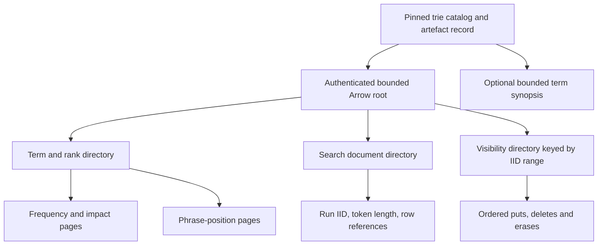
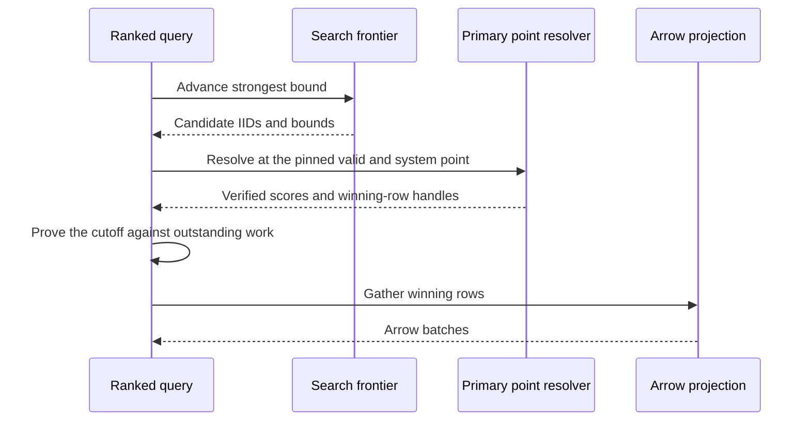
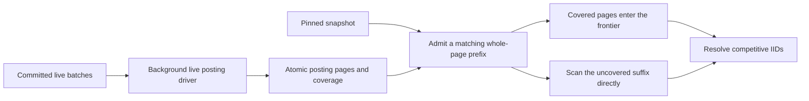

# RTDB full-text search improvement plan

## Objective

Return exact ranked SQL rows after inspecting only the search and primary data needed to prove the result at the requested bitemporal snapshot.
Use Arrow for durable search pages, live posting pages, intermediate batches and output.
Keep the primary resolver as the authority on visibility, SQL predicates and projection.

At the start of this work, `main` writes format 11 search objects with a Tantivy payload.
The qualified `perf/fts-exact-ranked` branch adds formats 12 and 13 and provides the Arrow ranking baseline.
Its 1M-document warm p95 was 5.2 ms for uniform scores at `LIMIT 20`, 26.1 ms at `LIMIT 100`, and 64.6 ms for dense varying scores at `LIMIT 20`.
Its 120K-document concurrent replay reached 17.6 ms p95 across 120 queries with 98 overlapping writes.
The landing integrates that search work forward into `main` and preserves the held world, canonical identity, catalog, and storage changes made there since the branches diverged.

## Architecture decisions

- **Elasticsearch and Lucene.** Block-max WAND and MAXSCORE use score ceilings over groups of postings.
  RTDB applies the same pruning principle to bounds ordered by score and certified identity, with visibility and SQL predicates resolved at the requested bitemporal point. [Lucene's block-max MAXSCORE design](https://www.elastic.co/search-labs/blog/more-skipping-with-bm-maxscore)
- **Tantivy.** Independent immutable segments keep postings, positions and field data under a small published catalog.
  RTDB uses its existing trie and partition-group identities as the immutable publication units for Arrow search. [Tantivy architecture](https://github.com/quickwit-oss/tantivy/blob/main/ARCHITECTURE.md)
- **Quickwit.** A split can retrieve its small directory and hot cache from object storage before loading the data required by the query.
  RTDB puts the authenticated root address directly in its trie catalog so discovery can begin with one bounded range read. [Quickwit architecture](https://quickwit.io/blog/quickwit-101)
- **turbopuffer.** Object storage holds durable state, and SSD caching and query affinity reward repeated reads.
  RTDB reuses its object-store disk cache and budgets decoded search pages separately. Cold and warm results are measured independently. [turbopuffer architecture](https://turbopuffer.com/docs/architecture)
- **Chroma.** Query workers combine indexed data with recent durable log updates while compaction publishes Arrow-based indexes asynchronously.
  RTDB applies that division at the live table boundary, where a snapshot can query completed posting pages and scan its uncovered suffix. [Chroma's search storage](https://www.trychroma.com/engineering/serverless) and [write-ahead log](https://www.trychroma.com/engineering/wal3)

## Authenticated Arrow pages

Publish one immutable format 14 Arrow IPC object for each eligible trie or partition group and search definition.
Record the format, definition, storage identity, and bounded root locator in the existing artefact record statistics.
A root locator identifies a checked Arrow batch and can be read directly by a range-capable store.
The conventional IPC footer supports offline inspection and whole-file readers.



```rust
struct PageRef {
    offset: u64,
    metadata_len: u32,
    body_len: u64,
    digest: [u8; 32],
}

struct SearchRoot {
    terms: PageRef,
    documents: PageRef,
    visibility: PageRef,
}
```

The parent supplies the digest and expected type for each child.
Directory pages have bounded fanout and leaf size.
A termless source can be omitted from candidate discovery when a compatible complete synopsis proves absence.
The visibility route remains keyed by the pinned primary sources, the IID, and independently safe bounds.
A later put that says `paid` can hide an older `invoice` even when its own file cannot nominate a match.
Use the primary source selection and canonical event ordering for all evidence.
Treat deletes, erases, non-text puts, and unresolved or missing pages as first-class cases.

Intersect term frequencies first and load position pages for the remaining phrase candidates before fetching their document and IID visibility pages.
Cache pages by database incarnation, immutable object identity and page range.
The cache shares concurrent fills, makes failed or cancelled fills retryable, and admits page bytes before retaining a checked batch.
For missing pages, the range planner coalesces gaps of up to 64 KiB into spans of up to 1 MiB and fetches up to eight spans concurrently.
It requests the whole object when the missing pages cover at least three quarters of it.
Reuse local maps and whole-object disk-cache entries when available.
Readers with prepaid cache allocations keep their retained buffers inside that allocation.

## Shared exact ranking frontier

Place unread persisted and live rank nodes, pending candidates and outstanding verification bounds in one query-local frontier.
An unopened source carries a conservative bound until the directory provides stronger evidence.
Prioritize candidates by the best remaining rank bound.
Cap prefetch and verification in flight using the query budget.

For one unit-weight scoring term, store the largest observed canonical contribution and the smallest certified integer SQL ID among postings attaining it.
An unknown ID at the maximum makes its tie bound unknown.
For multiple terms, add conservative ceilings in canonical SQL order and use the minimum known ID of the entire window only when every run has a certified ID.
The stronger ID cutoff applies to the supported order at one valid/system point in one partition.
Keep equal or unknown bounds competitive.
A cutoff requires `k` verified rows and a strict proof against every unresolved source.

```rust
fn discard(upper: Bound, kth: VerifiedKey, order: ProofOrder) -> bool {
    match upper.score.cmp(&kth.score) {
        Some(Ordering::Less) => true,
        Some(Ordering::Equal) if order.certifies_integer_id() => {
            upper.id.zip(kth.id).is_some_and(|(lower, winner)| lower > winner)
        }
        _ => false,
    }
}
```

Canonical score comparison treats signed zeroes as equal.
A range, unsupported sort, mixed identity, or explicit-corpus query uses the strongest proof available for its shape and can use the existing SQL scan.
A failed or budget-limited accelerated attempt falls back before emitting ranked rows and keeps the same read snapshot.

## Point resolution and projection

The query asks the primary resolver to resolve a batch of competitive IIDs at its pinned point.
The resolver selects the winning versions, evaluates `MATCH` and residual predicates, and returns bit-compatible scores with snapshot-bound row handles.
Final projection gathers the winning columns from those handles in SQL order.
Keep handles only for current winners and release displaced handles promptly.
Each handle retains the verified Arrow batch and its row index.
If the query cannot retain the winning batches within its memory budget, it scans the narrowed IIDs under the original snapshot and storage read lease.



The ranked reader chooses the phrase path using the measured warm workload when both files exist.
Phrase ranking uses the retained format 13 reader when it covers every candidate source offered by format 14.
Format 14 still checks phrases from its own positions when the format 13 copy is absent.

## Background live posting coverage

A per-database driver subscribes to immutable committed batches and publishes completed Arrow pages and their coverage prefix together.
The snapshot admits only whole pages whose immutable row lineage and positions fit its pinned segment.
Chunk coalescing preserves that lineage, and the posting cache holds a weak proof so it can release a flushed segment.
The lineage chain starts a new generation after 4,096 revisions and schedules coverage again.
This bounds its metadata independently of transaction memory admission.
Covered live pages join the persisted frontier.
The query scans every row of the uncovered suffix and any uncovered transaction overlay without waiting for the driver.
The primary live index supplies visibility evidence for all events.
Source selection at a flush boundary follows the authoritative pinned catalog and live segments.



## Object roles

| Object | Role | State and lifetime |
| --- | --- | --- |
| Artefact driver | Existing active object | Selects builds, repairs and publication for one database. |
| Live search driver | Active | Selects bounded live posting work and publishes coverage for one database. |
| Live coverage and search root | Passive immutable values | Hold checked coverage or checked page references for one generation. |
| Arrow page cache | Monitor | Owns independently charged page entries and conditions for in-flight fills. |
| Search reader and range planner | Passive | Validate and plan page reads on the caller's coroutine. |
| Rank frontier | Passive | Owns transient rank and verification state for one query. |
| Point resolver and resolved row handle | Passive | Use the caller's pinned catalog, events and storage read region. |

## Migration, publication and rollback

Preserve format 11, 12 and 13 readers and keep existing artefacts through the format 14 rollout.
The format 11 adapter stages a temporary Arrow representation in a private mapped file and charges the conversion workspace separately.
Ranked point SQL can combine format 14 sources, earlier formats and an uncovered live suffix in one frontier.
Install compatible readers throughout a deployment before enabling format 14 publication.
Validate complete deterministic bytes before appending the catalogue entry through the existing artefact lane.
Keep repair and publication subject to the existing identity, storage epoch, read admission and collection contracts.
Read the highest supported recorded generation for the surface in use and preserve primary fallback when coverage is incomplete.

## Qualification and landing

1. Add per-query diagnostics for opened roots, IO bytes and requests by page kind, cache reuse, expanded rank nodes, scored runs, resolved IIDs, reopened primary pages, uncovered live rows and fallback reason.
2. Compare results with exhaustive SQL, including score bits and output order, for equal scores, mixed IDs, multiple terms, phrases, structured filters, point and range cuts, backdated puts, nonmatching corrections, deletes and erases.
3. Cover mixed-format restart, reader-first rollout, corrupt and missing page repair, transient storage failure, cancelled cache fills, memory pressure, compaction and collection under a pinned read, lagging live coverage and flush handoff.
4. Run qualification on the release tree after integrating the complete implementation.
   Run the repository's native suites and Gradle unit, integration and property suites with the built FFI library.
5. Interleave release benchmarks for the qualified baseline and new reader on the same corpus and object-store deployment.
   Use at least 200 warm observations per query to estimate p95 and report sample counts and hardware.
   Target 20 ms warm p95 for dense `LIMIT 20` and uniform `LIMIT 100` at 1M documents, and preserve uniform small-limit and replay performance.
   Measure cold sparse visibility bytes, GET count, latency and cache pressure from a fresh node.
   The native benchmark command below writes both formats against the same trie set and alternates the two readers against the same expected rows.

   ```sh
   cargo run --manifest-path rust/Cargo.toml --release -p rtdb-node --features fts-experiments --example fts_architecture_bench -- ranked-sql 1000000 200
   ```

   Use `fts-experiments,azure` and supply `RTDB_FTS_AZURE_EMULATOR`, `RTDB_FTS_AZURE_ACCOUNT` and `RTDB_FTS_AZURE_KEY` to repeat against an Azure Blob emulator.
   The command opens a new node after publication with a fresh disk cache and samples the first sparse ranked query before warming the fixture.
   Its JSON includes raw latencies, root and expansion counts, range bytes and requests, page-cache hits, and verifier and retained-row counts.
   Use `workload 120000 20` with the same release binary to replay six format 13 query shapes during writes, including historical and range cuts.
6. Review the actual landing diff and verify the remote `main` tip is an ancestor of the qualified tree.
   Push the finished tree to `main` once, by fast-forward.

## Release measurements

The interleaved release benchmark used 1,000,000 documents over 50 tries, with 200 warm samples per reader and query shape on an Apple M6 with 24 GiB of memory.
Both readers served the same persisted tries and every run compared its rows and scores with exhaustive SQL.
The baseline uses format 13 and the selected reader uses format 14 where eligible.
The phrase case uses format 13 on both sides because the fixture contains both generations.

| Query | Format 13 p95 | Selected reader p95 |
| --- | ---: | ---: |
| Uniform `LIMIT 20` | 6.52 ms | 3.49 ms |
| Uniform `LIMIT 100` | 29.38 ms | 15.45 ms |
| Dense varying score `LIMIT 20` | 51.12 ms | 5.66 ms |
| Selective `LIMIT 20` | 19.84 ms | 15.49 ms |
| Phrase `LIMIT 20` | 20.62 ms | 20.56 ms |

On a separate 120,000-document Azurite fixture, the first sparse query took 563.95 ms from a fresh node and disk cache.
The search reader fetched 12,183,872 bytes in 412 HTTP ranges, including 1,601,856 bytes in 27 visibility ranges.
The request and byte counts cover the search reader on the local emulator.
