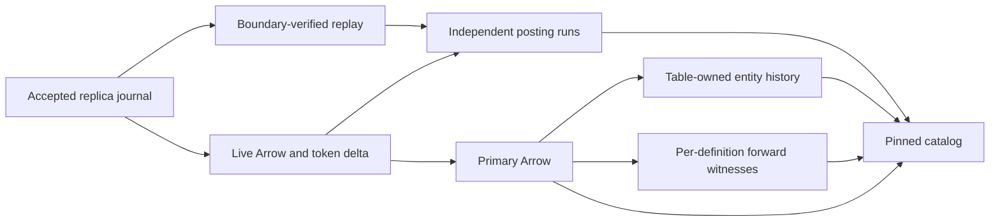
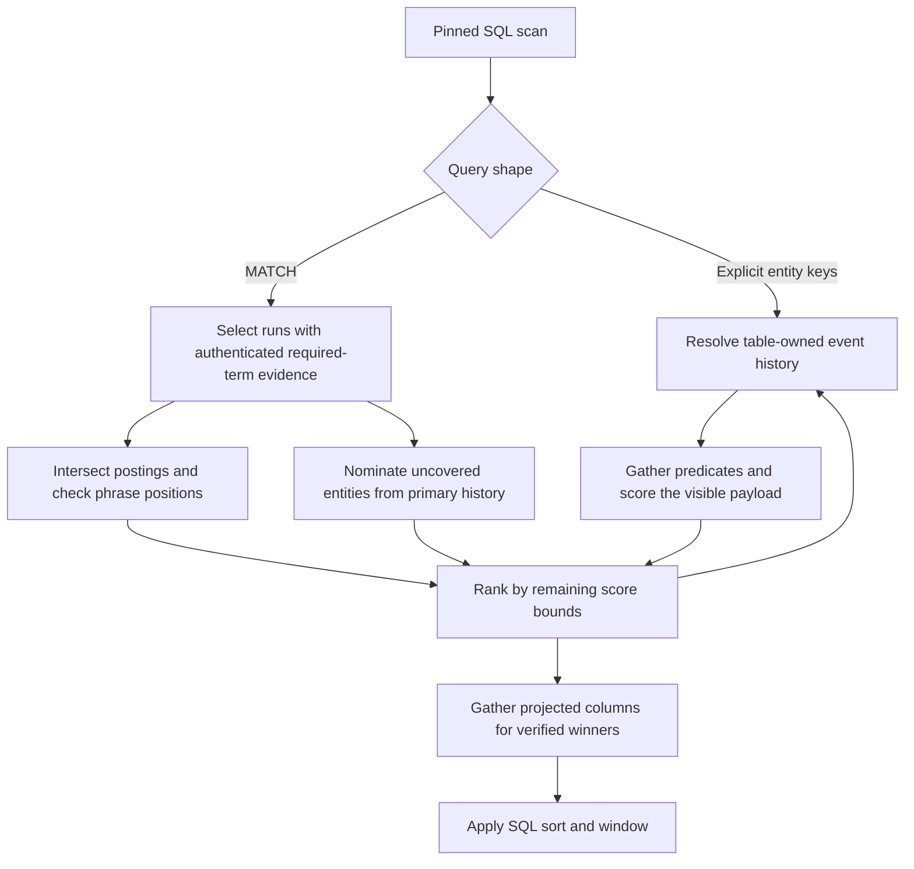

# RTDB logical full-text postings

Set `search: {writeFormat: 16}` on a native node to enable logical postings for public, history-enabled search definitions.
A native writer in this mode also records shared table history that ordinary point scans can use on tables without a search definition.
The same pinned catalog determines which version is visible and where its payload lives.

## Data and ownership

| Object | Role | Owns |
| --- | --- | --- |
| `EventOrigin`, `RowVersion`, and `SearchRowLocation` | Passive values | Accepted event identity, temporal order, and a physical location at one captured cut. |
| `EventBatch`, `OwnedBatch`, and `StagedWrite` | Passive values | Charged Arrow buffers and the write's events in commit order. |
| `HistoryWriter`, `HistoryRoot`, `HistoryRange`, `HistoryPage`, and `ForwardPage` and `HistoryObject` | Passive objects | A single writer's authenticated directory and immutable header or revision pages. |
| `EntityHistoryArtefacts`, `EntityHistoryBuilder`, and `SearchBuilder` | Passive builders | The build inputs and publication ports for table history and search. |
| `SearchRun`, `SearchManifest`, and `LogicalCoverage` | Passive values | Source extents, authenticated routing, and active and retired run receipts. |
| `PageDigest`, `RootRef`, directory pages, and `DirectoryManifest` | Passive values | Authenticated routing data and the active and retired roots of one table's catalog. |
| `EntityDirectoryBuilder` and the copy-on-write writer | Passive builders | One sealed source prefix and the pages changed by its edits. |
| `ObjectPageStore`, `FreshPages`, and `DirectoryRead` | Passive adapters | Immutable page I/O and the catalog and memory scope of one read. |
| `TermDirectoryRoot`, `TermStats`, and `TermRoutes` | Passive values | The pinned directory receipt, a term's statistics for one run, and the matching run bounds for one query. |
| `TermSummaries`, `PreparedLogicalRun`, `DirectoryUpdate`, `TermEdits`, and `MaxUnitBound` | Passive objects | Writer-owned Arrow summaries and staged run receipts, a directory build request, sorted tree edits, and the bound fold for immutable pages. |
| `ObjectPageStore` and `ArchiveTermPages` | Passive storage adapters | The term directory's table prefix and access to authenticated pages. |
| `RetainedArtefactJournal` and `PrepareSearch` | Passive adapters | Access to verified retained replay and to the file builders invoked by sealing. |
| `ReplicationDriver` and the artefact driver | Active objects | Ordered adoption and replay, and selection and scheduling of independent build work. |
| `TrieCollector` | Passive cycle worker | The eligibility observations and receipts used by a collection cycle. |
| `QueryRanking` | Monitor | One frontier, work admission, and the verified SQL prefix across the pinned partitions. |
| Ranked scan workers | Active objects | Claiming work and publishing its outcome under the scan's task lifetime. |
| `PartitionRankSource` and `ScanVerifier` | Passive objects | Partition coverage, posting readers and visibility and predicate evaluation at the pinned cut. |
| `RankWork`, `RankOutcome`, `VerifiedRankRow`, and `QueryWinners` | Passive values | Bounded work, child tasks, verified version and score evidence, and the retained rows by partition. |
| `RankClaim` | Passive guard | An outstanding bound through publication or cancellation. |

```rust
struct EventOrigin {
    accepted_commit: [u8; 16],
    event_ordinal: u64,
    original_block: i64,
}

type TextRevision = [u8; 32];
// Hash the analyzer generation and the ordered, length-prefixed token sequence.
```

An accepted commit assigns event IDs before journaling.
Replay, forks that preserve accepted Arrow, L0 sealing, and primary compaction preserve those bytes.
An event split into disjoint fragments can have several locations at a captured cut.
Receipts from older data can still use the original temporal coordinates when they unambiguously identify events.

A table history page stores event headers and physical row coordinates.
A separate forward page stores each field's revision, keyed by the accepted event.
Equivalent analyzed text shares a posting revision for the same field and entity.
A forward witness identifies whether a posting refers to the resolved event's text revision.
The ranked verifier uses the primary row to determine the visible version's score.
A point read follows the pinned table directory to the selected entity histories and adds accepted events from the suffix.
The directory keeps headers, stable origins, and an Arrow location hint through its sealed block.
Where events carry typed keys, the full key delimits the history behind the routing IID.
Compaction preserves event origins, so a reader can find a relocated payload when the hint's trie has retired.
Each erase advances the entity's frontier and removes earlier events, including for reads at older system times.
Primary compaction preserves the erase marker's all-time bounds for scan pruning and keeps it ordered with reinsertions at the same system time.
A directory can bootstrap from retained L0 sources with stable event origins.
Legacy points can route through per-trie histories or the selected primary pages.
Upgrade readers and compaction workers together with ingest writers when enabling this mode or upgrading an existing format 16 deployment.
Older writers can discard the optional event identity and cannot reproduce the resulting compaction output at the same key.



## Publication, coverage, and recovery

Posting runs cover the table's accepted events in a set of blocks within one storage partition.
Each receipt binds that extent, the definition and generation, the file length, the root locator, and a unique upload allocation.
The checkpoint stores active and retired receipts with the table.
A replacement can adopt the exact union of its still-active inputs in one ordered update.

Each table and format 16 definition generation can hold a term directory over its active runs.
The analyzer version is part of the definition ID.
Directory rows are ordered by field, exact analyzed term, and run digest.
Each row records document frequency, maximum term frequency, minimum stored length, a unit score bound, and the first and last posting window.
The search writer takes these statistics from the run's Arrow term table and rank roots.
Each directory branch carries the largest unit score bound of its descendants.

An update writes immutable pages for the affected paths and publishes the root together with the run addition or replacement.
Each write attempt gives its new pages distinct digests, including when a rebuild produces the same rows, so a concurrent sweep of older pages cannot remove the rebuilt directory.
Adoption compares the expected root and active run identities.
A change from an older writer invalidates routing for its generation until the lane rebuilds it from the active runs.
The checkpoint stores the active roots.
Replay archives include the pages reachable from those roots.

The writer stores a bounded `search-pending` intent with its `SearchStagingOwner` before uploading the immutable run.
An upload error leaves the intent available to the collector because the provider can still complete the request.
Hosted collection proves drain once the writer epoch has turned over and the original storage region has left the deployment.
Native local collection proves drain by acquiring the released flock witness of the recorded attachment.
After the source cut is installed and the writer has drained, the collector can record abandonment of the completed body with its immutable publication where required.
If a fresh observation finds the body absent, the collector can remove the intent.
Adoption and abandonment are mutually exclusive at that allocation.
The retirement can release the body after reader and checkpoint protection drains.
In hosted storage, a version-scoped archive hold in the same provider namespace retains a terminal-published run by its provider key.
A retired run at an unrelated provider key can record its release while the archive copy drains.
An abandoned allocation remains fenced through checkpoint recovery.
Incomplete provider uploads are handled by the provider's publication journal where available.
Hosted storage authenticates ranges of new logical runs and history sidecars with independently encrypted frames.

The lane can reconstruct a run from retained L0 files.
For supported native local journals, it can recover from the captured checkpoint's verified replica prefix when original primary files are missing.
The repair checks the table's replayed event count and the requested extent before publication.
Replay supplies the erase frontier, so recovery can discard pre-erase text and preserve later writes.
Events in the same commit retain source order for erasure.
Maintenance reconstructs older runs containing erase witnesses before adopting them into ordered replacements.
A retry after a table checkpoint is staged reuses its receipts while publishing the root.
The same table checkpoint records the directory receipt, the hosted writer epoch when available, and the digest of its ordered erase frontier.
The receipt's row count includes each retained event and one frontier row per erased entity.
Each update names the expected predecessor root in the ordered catalog.
An immutable directory page is addressed by its content digest, and a later seal reuses the untouched subtrees.
A seal advances the entity directory only on stores that can release retired directory pages.
The per-trie history sidecar can still be sealed on stores without directory-page release.
Checkpoint replay archives include every page reachable from the active root and keep the live primary payloads.
Collection protects pages reached by installed checkpoints, captured readers, and retired roots whose reader lease is still open.
Hosted releases also require immutable provider evidence and clearance of fork and archive holds.

## Query execution



Candidate selectors combine covered runs, uncovered history, and the live suffix.
A failed run contributes a gap while healthy runs remain usable.
If a bounded gap scan cannot account for all uncovered data, the query uses the authoritative scan.
A ranked point scan with at most 128 explicitly selected IIDs can score resolved entities directly through table history.
Other scans intersect directory routes for the required terms, starting with the rarest, and exclude runs that lack any required term without opening them.
The query adds each run's term bounds in the scoring query's order and uses the result to prioritize unopened runs.
Sparse conjunctions expand the rarest term and batch posting intersections, while dense searches expand score-bounded windows.
A phrase additionally checks positions in the candidate posting sequence.
If the directory is missing or unreadable, the lane receives a repair request and the query uses the run synopses.
A ranked point query keeps one frontier for the pinned partitions and one verified prefix sized for OFFSET plus LIMIT.
A worker holds its bound while reading, expanding postings, or verifying rows and publishes its outcome together with the replacement bounds.
Unknown work, including gaps and unread live suffixes, stays eligible until it has been accounted for.
Only a verified visible version enters the prefix.
SQL tie order is available across partitions when the ascending identity is an integer or UUID.
A score-only ceiling can prune only when its score is strictly below the cutoff.
The scan gathers final projection columns after the query fixes its winners.

```yaml
search:
  writeFormat: 16
```

Protection and governed ownership still follow the held-table authorization and corpus rules.
Legacy file formats remain readable, and unsupported scan shapes can use the complete primary resolver.
