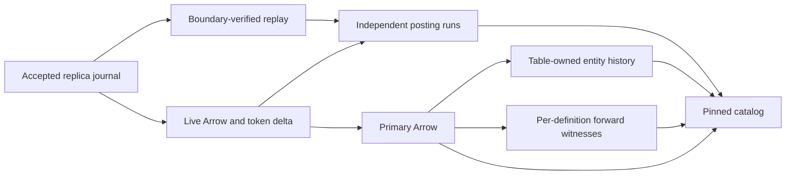
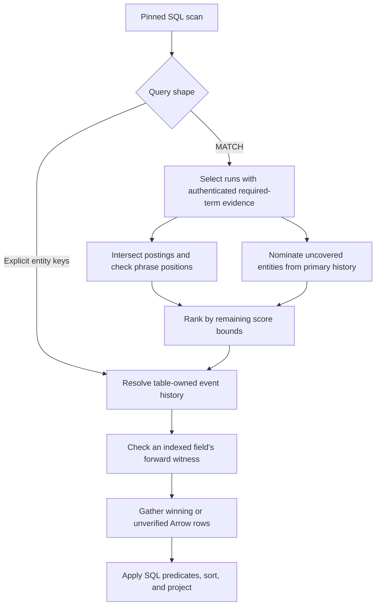

# RTDB logical full-text postings

Set `search: {writeFormat: 16}` on a native node to enable logical postings for public, history-enabled search definitions.
A native writer in this mode also records shared table history that ordinary point scans can use on tables without a search definition.
The same pinned catalog determines which version is visible and where its payload lives.

## Data and ownership

| Object | Role | Owns |
| --- | --- | --- |
| `EventOrigin`, `RowVersion`, and `SearchRowLocation` | Passive values | Accepted event identity, temporal order, and a physical location at one captured cut. |
| `EventBatch`, `OwnedBatch`, and `StagedWrite` | Passive values | Charged Arrow buffers and the write's events in commit order. |
| `HistoryWriter`, `HistoryRoot`, `HistoryRange`, `HistoryPage`, and `ForwardPage` and `HistoryObject` | Passive objects | A single writer's authenticated directory and immutable header or revision pages. |
| `EntityHistoryArtefacts`, `EntityHistoryBuilder`, and `SearchBuilder` | Passive builders | The build inputs and publication ports for table history and search. |
| `SearchRun`, `SearchManifest`, and `LogicalCoverage` | Passive values | Source extents, authenticated routing, and active and retired run receipts. |
| `RetainedArtefactJournal` and `PrepareSearch` | Passive adapters | Access to verified retained replay and to the file builders invoked by sealing. |
| `ReplicationDriver` and the artefact driver | Active objects | Ordered adoption and replay, and selection and scheduling of independent build work. |
| `TrieCollector` | Passive cycle worker | The eligibility observations and receipts used by a collection cycle. |
| `PartitionRanking` | Monitor | Waiting partitions, ranked task admission, and the verified score cutoff for one compatible shared query basis. |
| `PartitionRankWork` and `RankWorkPermit` | Passive guards | The lifetime of pending and admitted work in that query. |

```rust
struct EventOrigin {
    accepted_commit: [u8; 16],
    event_ordinal: u64,
    original_block: i64,
}

type TextRevision = [u8; 32];
// Hash the analyzer generation and the ordered, length-prefixed token sequence.
```

An accepted commit assigns event IDs before journaling.
Replay, forks that preserve accepted Arrow, L0 sealing, and primary compaction preserve those bytes.
An event split into disjoint fragments can have several locations at a captured cut.
Receipts from older data can still use the original temporal coordinates when they unambiguously identify events.

A table history page stores event headers and physical row coordinates.
A separate forward page stores each field's revision, keyed by the accepted event.
Equivalent analyzed text shares a posting revision for the same field and entity.
A forward witness must match the resolved event's identity before a posting can certify its score.
Older revisions and absent witnesses can be checked by scoring the resolved primary row.
A point read uses table history where a trie has it and reads only the routed primary pages of a trie that does not.
Data written before table history therefore keeps entity-level reads instead of falling back to a table scan.
Upgrade readers and compaction workers together with ingest writers when enabling this mode or upgrading an existing format 16 deployment.
Older writers can discard the optional event identity and cannot reproduce the resulting compaction output at the same key.



## Publication, coverage, and recovery

Posting runs cover the table's accepted events in a set of blocks within one storage partition.
Each receipt binds that extent, the definition and generation, the file length, the root locator, and a unique upload allocation.
The checkpoint stores active and retired receipts with the table.
A replacement can adopt the exact union of its still-active inputs in one ordered update.

The writer stores a bounded intent before it uploads the immutable run.
Collection observes the intent and the completed object, obtains provider version evidence where required, and submits abandonment through the ordered catalog.
Adoption and abandonment are mutually exclusive at that allocation.
The retirement can release the body after reader and checkpoint protection drains.
An abandoned allocation remains fenced through checkpoint recovery.
Incomplete provider uploads are handled by the provider's publication journal where available.
Hosted storage authenticates ranges of new logical runs and history sidecars with independently encrypted frames.

The lane can reconstruct a run from retained L0 files.
For supported native local journals, it can recover from the captured checkpoint's verified replica prefix when original primary files are missing.
The repair checks the table's replayed event count and the requested extent before publication.
Replay supplies the erase frontier, so recovery can discard pre-erase text and preserve later writes.
Events in the same commit retain source order for erasure.
Maintenance reconstructs older runs containing erase witnesses before adopting them into ordered replacements.
A retry after a table checkpoint is staged reuses its receipts while publishing the root.

## Query execution



Candidate selectors combine covered runs, uncovered history, and the live suffix.
A failed run contributes a gap while healthy runs remain usable.
If a bounded gap scan cannot account for all uncovered data, the query uses the authoritative scan.
The synopsis can exclude a run for a required term at the captured manifest without opening the run.
A phrase additionally checks positions in the candidate posting sequence.
A ranked query prioritizes ready work across compatible partitions and shares a score cutoff derived from verified rows.
Unknown and exact-gap work keeps an unbounded score until it can nominate candidates.
SQL tie order remains authoritative at equal scores.

```yaml
search:
  writeFormat: 16
```

Protection and governed ownership still follow the held-table authorization and corpus rules.
Legacy file formats remain readable, and unsupported scan shapes can use the complete primary resolver.
