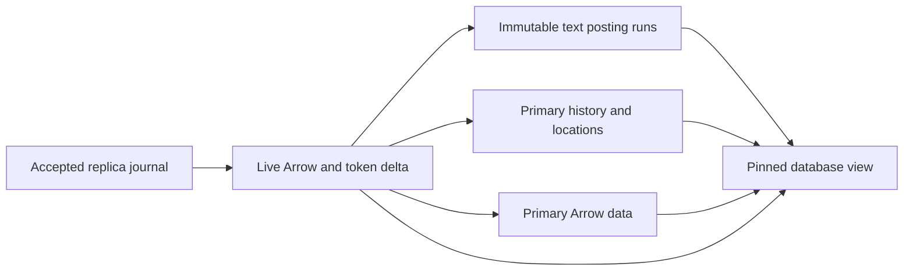
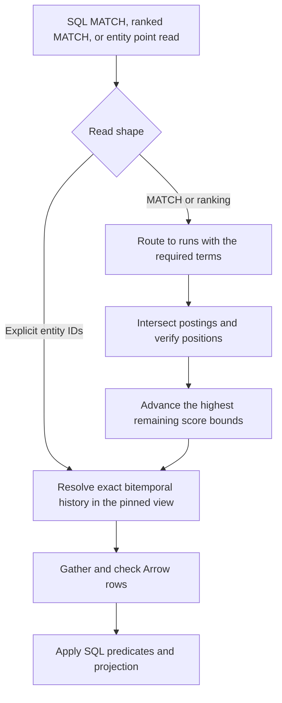

# RTDB logical full-text postings

Set `search: {writeFormat: 16}` on a native node to enable logical postings for public history-enabled search indexes.
The durable index describes text revisions, and the primary catalog describes where each event lives in Arrow.
Primary compaction can replace an event's locator while a logical posting run stays byte-for-byte identical.

## Data and ownership

| Object | Role | Owns |
| --- | --- | --- |
| `SearchRun` and `SearchManifest` | Passive | Run identity, provider receipt, source extents, authenticated root locator, and replacement history. |
| Primary history file | Passive | Sorted event headers, text-revision witnesses, and Arrow page and row coordinates for one primary trie. |
| `PartitionValue` and `Snapshot` | Passive | One immutable cut of live Arrow, primary catalog, and posting manifest. |
| `ReplicationDriver` | Active | The ordered publication and replay of transaction deltas, run replacements, and checkpoint adoption. |
| `SearchBuilder` and the artefact driver | Passive builder and active driver | The artefact driver owns job scheduling and publication; the builder produces immutable receipts and files from captured inputs. |
| `TrieCollector` | Active | Catalog-aware search retirement and acknowledgement after a provider release. |
| `SearchRuntime` and `PartitionRanking` | Monitor | Charged caches, repair reports, admission telemetry, and query-scoped verified ranking bounds. |

    RowVersion = (entity IID, system-from, commit position), scoped to a captured table lineage
    TextRevision = SHA-256(analyzer version || exact UTF-8 bytes)
    PostingDocument = (entity IID, indexed field, TextRevision)
    ArrowLocation = (pinned primary trie, page, row)

Byte-identical text shares one posting document per entity and field within a run.
The analyzer version domain-separates revisions.
The event history records a separate revision witness for each indexed text field, including the distinction between a text value and an absent witness.
An ambiguous legacy event order falls back to the authoritative scan.

## Publication and recovery

For admitted ordinary commits, the leader analyzes each indexed text cell and serializes a bounded Arrow token delta with the resolved transaction.
Replay installs the accepted delta with the live Arrow events at the same basis, and advances each indexed column's contiguous prefix only when it can account for every new row.
An absent optional delta leaves the prefix intact and the wider tail available through the exact scan.
Guarded transaction acceptance retains its existing staging and inline payload path.

At seal, a run covers the table's extent in a specific L0 block, while a history file records the same block's event locations.
The checkpoint serializes the run receipt with the table catalog, and the block notification carries the receipt for replay.
For historical backfill the artefact lane reads retained L0, then merges comparable posting runs from their own Arrow token sequences.
An ordered replacement compares the still-active inputs and must cover exactly their union.
A rejected replacement with an ordered upload receipt enters the retirement inventory.
A read requires all retained source extents, with a row-count check against the durable table metadata.
Each receipt binds its table, definition, extent list, and rebuild number to a content-addressed file and authenticated Arrow root.
The root carries a term synopsis and a page tree for selective lookup.

A repair report for a missing or corrupt run triggers a fresh read.
If the run needs replacement and its original L0 inputs are available, the lane publishes a new authenticated run over the same extents.
The exact scan serves the query while coverage is missing.
Posting runs retain erase witnesses and the latest contributing event order for each text revision.
The lane scrubs revisions that precede an erase and preserves later writes of the same text.
Reader holds, checkpoint coverage, and the collection lease protect superseded runs.
Hosted reclamation carries provider evidence and advances the catalog admission floor before recording the release.

## Query execution

A sparse phrase read starts from the least frequent mandatory term and coalesces posting windows.
Dense ranked reads use the block-max hierarchy.
The scan resolves nominees with the same temporal resolver used for bounded entity point reads.
Trusted witnesses can defer materializing the Arrow payload until after the ranked prefix is known, and the gather checks the row version.
Query-wide verified scores can prune work across concurrent partitions at a common basis.
An equal-score bound stays live when the SQL tie order is uncertified.

## Scope

Format 16 applies to public history-enabled definitions, with format 15 retained for protected and current-only definitions.
An explicit entity point read can use the history access path on a covered table with a qualifying search definition.
Historical backfills and repairs require accessible original L0 inputs.
An upload whose process dies before any ordered receipt reaches the catalog can leave an untracked object.
Coverage gaps, allocation refusal, and incompatible read shapes use the regular SQL path.

The durable Arrow implementation is exercised by the `ranked-logical` mode of `fts_architecture_bench`, which interleaves formats 15 and 16 against the same primary files and verifies results against exhaustive SQL.
