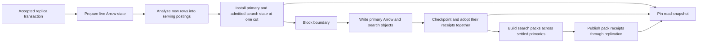
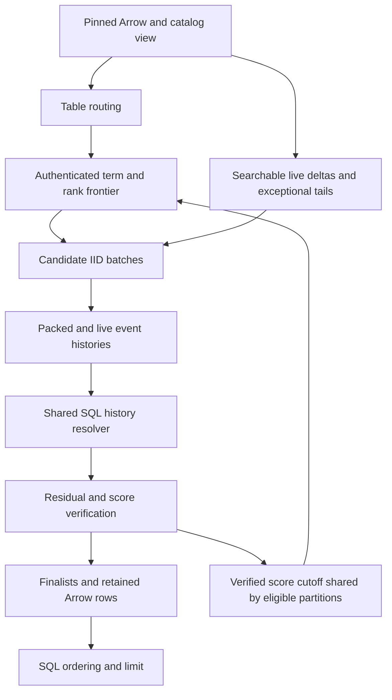

# Snapshot-native full-text search

Format 15 serves indexed text, event visibility, and primary Arrow payloads from one read snapshot.
Its logical row-version key is the entity IID, system-from timestamp, and transaction commit position within one table and database history.
An event keeps this identity when compaction assigns a new primary page and row.
The read view owns the catalog cut and live segments from which all three parts are accessed.

## Publication



The replication driver is the active owner of transaction order and invokes a search builder before installing a prepared live write.
The index partition is the monitor that installs a complete value under its lock.
The prepared write, serving postings, row-version key, object locators, and table routing are passive values.
An immutable live table publishes its append-only coverage frontier with its admitted posting pages.
Earlier cuts retain their own table and search references.
Sealing reuses Arrow token slices when a primary row maps unambiguously to covered live postings.
Rows outside that evidence are analyzed from the sealing input.

A pack may bundle two to eight settled primary tries with disjoint IID prefixes and one logical recency.
The independent artefact lane builds a pack from those primary files and records the canonical member list on each member.
Compaction can publish a singleton alongside its new primary, with the same logical row-version keys and new physical locations.
The search lane can subsequently consolidate compatible singletons.
Old receipts and objects remain usable by pinned cuts until the last dependent primary is eligible for collection.
Recovery reconstructs L0 search receipts from table checkpoints and restores recorded pack memberships from catalog state.
An obsolete L0 search object can be collected after the checkpoint, catalog readers, and reader leases release it.
The primary L0 data and metadata retain their recovery custody.

## Ranked execution



Pack discovery reads the table receipt once per held trie catalog and definition.
A negative term synopsis or time section can omit a pack from nomination while its event histories remain eligible for visibility.
Each root authenticates its child ranges.
Roots that fit the compressed capsule budget travel in the catalog receipt and can carry direct routes to term or IID leaves.
Large roots are read by authenticated range.
Range batching uses observed storage latency and throughput to choose between separate reads, coalesced spans, and a small whole-object read under storage admission.

A candidate becomes a SQL row only after the history resolver processes its relevant packed and live events.
The same resolver handles a later nonmatching correction, delete, erase, valid-time split, or transaction-local write.
Incomplete evidence uses the ordinary primary history scan.
With a supported single MATCH residual, a posting may witness the exact resolved version until the final Arrow gather.
The gather checks the row version, score and any proved integer tie key.
Other accelerated shapes check the residuals and score on competitive primary rows.
An eligible partition can publish its SQL-verified scores to a query-local ranking monitor.
The coordinator uses a shared cutoff only at a common system basis and prunes a bound only when the score is strictly lower.
Ordinary SQL ordering decides remaining ties.

Serving postings hold their own admission.
The accelerated reader handles at most 2,048 unindexed live rows and 1 MiB of unindexed text per segment.
Larger gaps, unavailable reads, unsupported ranked shapes, and ambiguous logical versions use ordinary SQL evaluation.
Prepaid readers charge their own directory, range, and verification allocations.
Release diagnostics count packed resolutions, deferred payloads, retained ranked rows, shared cutoff pruning, and decline reasons.
The search runtime also counts failures that produce an exceptional gap during live preparation or sealing.

## Operation and qualification

Install a compatible reader and maintenance binary on every node sharing the database before opting into format 15.
Existing versions 11 through 14 remain readable and can coexist at a catalog cut.
The writer defaults to paged Arrow format 13.

```yaml
search:
  writeFormat: 15
```

Use `ranked-pack` to compare format 14 and format 15 over identical primary bytes, with the same SQL oracle and interleaved queries.

```sh
cargo run --locked --release --manifest-path rust/Cargo.toml -p rtdb-node \
  --features fts-experiments --example fts_architecture_bench -- ranked-pack 120000 20
```

The comparison reports candidate and payload work alongside elapsed time.
An installation should also measure commit latency, block-sealing latency, pack adoption, cold object-store requests, and mixed query and ingest performance with its own data and storage conditions.

## Release measurements

The local release benchmark interleaved 200 warm samples per reader and query on an Apple M6 with 24 GiB of memory.
Both readers used the same one million documents and 50 primary tries.
Every timed result, including scores and tie order, matched exhaustive SQL.
The format 14 reader used its existing format 13 path for the phrase case.

| Query | Format 14 p95 | Format 15 p95 |
| --- | ---: | ---: |
| Uniform `LIMIT 20` | 2.55 ms | 1.78 ms |
| Uniform `LIMIT 100` | 9.08 ms | 5.27 ms |
| Dense varying scores `LIMIT 20` | 7.64 ms | 7.47 ms |
| Selective `LIMIT 20` | 14.43 ms | 15.18 ms |
| Phrase `LIMIT 20` | 18.31 ms | 27.98 ms |

On separate cold runs of the 120,000-document Azurite fixture, the first sparse query took 537.92 ms with format 14 and 455.73 ms with format 15.
Search range requests fell from 412 to 369, including three root requests versus zero and 27 visibility requests versus six.
The search reader fetched 12.18 MB with format 14 and 19.60 MB with format 15 in those cold runs.
These are two single-query cold observations on a local emulator.

The [FTS specification](fts.allium) defines the correctness and retention contracts.
The [search crate reference](../../rust/crates/search/README.adoc) covers supported file formats and SQL entry points.
